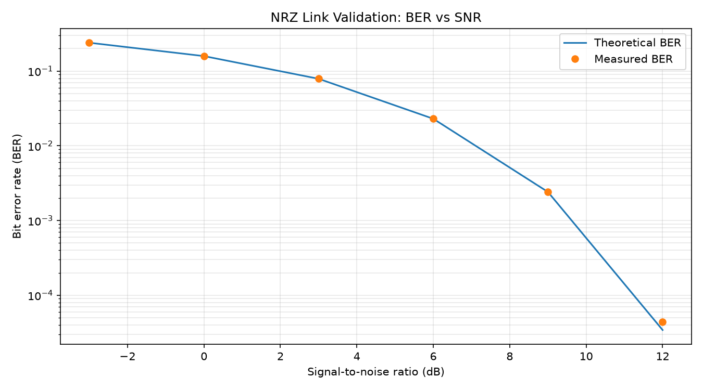
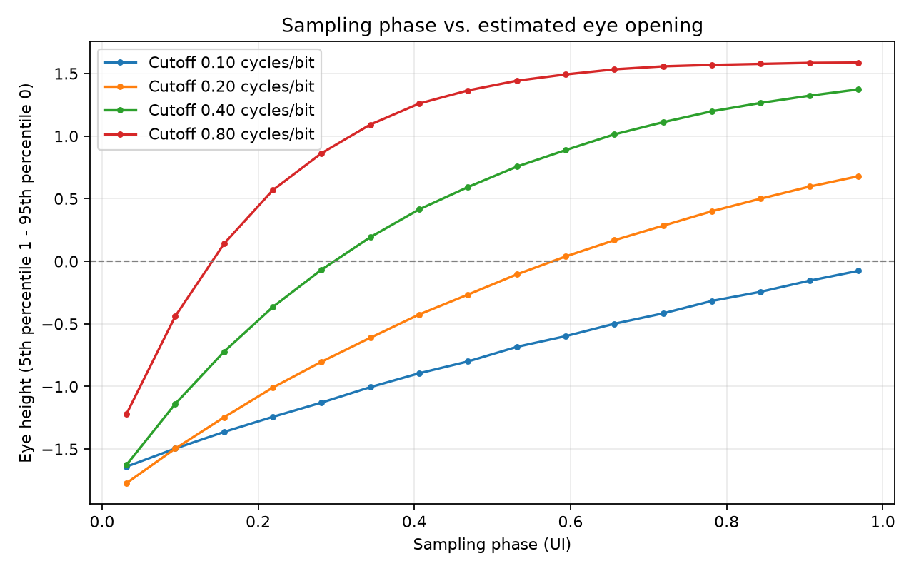
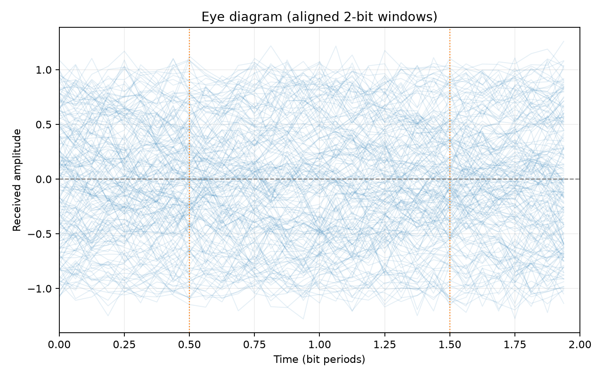
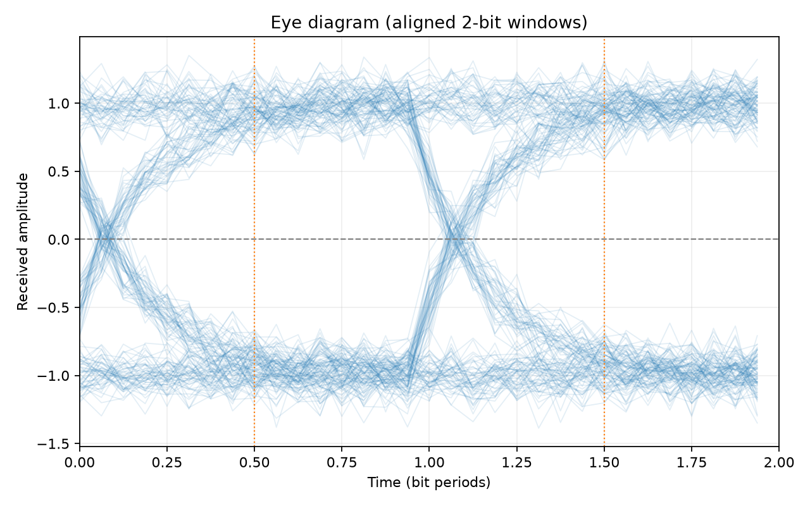

# Serial Link Validation and Signal Integrity Analysis

A Python-based project exploring how noise and limited channel bandwidth affect a simplified NRZ digital link. I built a simulation and automated test workflow to measure bit error rate (BER), visualize eye diagrams, characterize sampling margins, and flag channel configurations that do not meet a defined set of test limits.

This is a **behavioral simulation**, not a measurement of fabricated silicon or an implementation of a real PCIe/SerDes receiver. The pass/fail limits are project-defined for learning validation workflows, not industry compliance thresholds.

## Highlights

- Model binary NRZ symbols (+1 / −1) and additive Gaussian noise.
- Sweep noise standard deviation and signal-to-noise ratio (SNR); compare simulated BER with the analytical Gaussian-noise prediction.
- Model finite channel bandwidth using a first-order low-pass filter and examine intersymbol interference (ISI).
- Plot eye diagrams, estimate percentile-based eye height, and evaluate the sampling-phase window.
- Run automated pass/fail checks and export CSV and JSON reports.
- Run the `pytest` suite to check core simulation and validation behavior.

## Selected results

A regression run stored in `outputs/regression_report.json` used **20,000 generated bits per channel**, noise standard deviation **0.12**, **16 samples per bit**, and random seed **42**. The analysis excluded 10 initial bits for filter settling, leaving **19,990 evaluated bits** per configuration.

| Cutoff (cycles/bit) | Center BER | Center eye height | Timing window (UI) | Result |
| ---: | ---: | ---: | ---: | :---: |
| 0.10 | 27.369% | -0.684 | 0.000 | FAIL |
| 0.20 | 8.814% | -0.104 | 0.438 | FAIL |
| 0.40 | 0.000% | 0.756 | 0.688 | PASS |
| 0.80 | 0.000% | 1.442 | 0.875 | PASS |

Passing conditions in this particular run: BER ≤ 1%, center eye height ≥ 0.40 normalized units, and timing window ≥ 0.25 UI. **Two configurations passed and two failed.** A measured zero-error run does not prove zero underlying BER.

## Plots

**BER versus SNR** — simulated measurements compared with theoretical values:



**Eye height versus sampling phase** — the sampling margin depends on channel bandwidth:



**Representative eye diagrams:**

| Narrow bandwidth | Wide bandwidth |
|:--:|:--:|
|  |  |

## Run locally

Requires Python 3.10+.

```bash
python -m pip install -r requirements.txt
python -m pytest -q
```

Run individual experiments from the repository root (each script supports `--help`):

```bash
python serial_link.py             # waveform plot + single BER measurement
python ber_sweep.py               # BER vs noise standard deviation
python snr_sweep.py               # BER vs SNR, compared with theory
python channel_validation.py      # bandwidth sweep + eye diagrams
python eye_margin.py              # eye height vs sampling phase
python regression_validation.py   # pass/fail checks, CSV + JSON reports
```

Figures and result files are written to `outputs/` unless `--output-dir` is given.

### Reproducing the files in `outputs/`

The committed results were generated with larger bit counts than the script defaults, to reduce statistical scatter at low BER:

```bash
python serial_link.py
python ber_sweep.py --bits 1000000
python snr_sweep.py --bits 1000000
python channel_validation.py --bits 100000
python eye_margin.py
python regression_validation.py
```

With the fixed seed (42), error counts reproduce exactly. Theoretical BER values may differ in the last floating-point digits across platforms, and `regression_report.json` contains a generation timestamp.

## Project structure

```text
serial-link-validation/
├── serial_link.py             # NRZ generation, noise, sampling, BER
├── ber_sweep.py               # BER vs noise characterization
├── snr_sweep.py               # BER vs SNR and theoretical comparison
├── channel_validation.py      # Bandwidth-limited channel and eye diagrams
├── eye_margin.py              # Eye height vs sampling phase
├── regression_validation.py   # Limits, pass/fail evaluation, reports
├── tests/                     # pytest suite (22 tests)
├── outputs/                   # Example plots, CSVs and JSON report
├── VALIDATION_REPORT.md       # Methods, observations, limitations
├── requirements.txt
├── pytest.ini
└── LICENSE
```

## What I learned

The same link can look reliable with ideal sampling and sufficient bandwidth, yet fail once the channel becomes bandwidth-limited. Comparing BER against theory helped me check the noise-only model, while eye-height and timing-window measurements exposed degradation caused by ISI. The regression layer ties measurements to explicit requirements and generates records that can be reproduced and reviewed.

## Limitations

The channel is a simplified first-order low-pass model and assumes known sampling timing; there is no clock-and-data recovery, equalization, transistor-level modeling, or hardware measurement. Eye height is estimated using percentile separation rather than a standards-based eye-mask test. See [VALIDATION_REPORT.md](VALIDATION_REPORT.md) for details.
